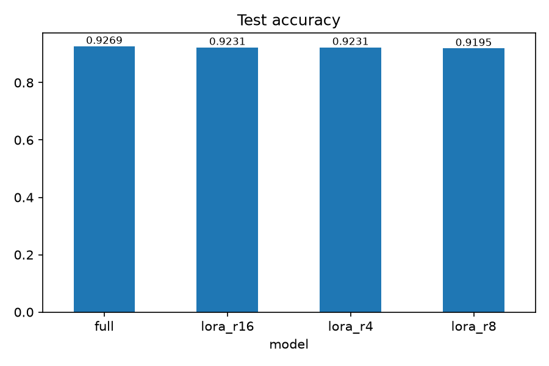
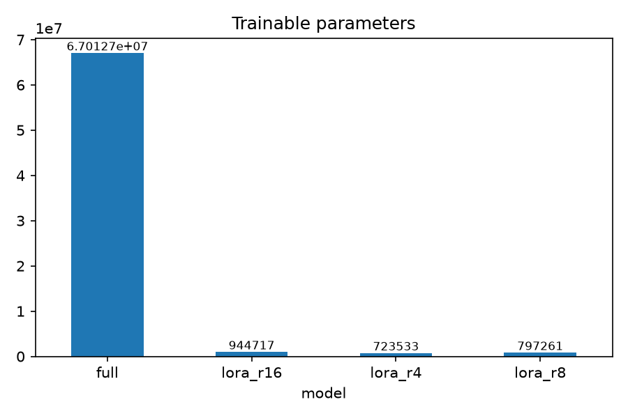
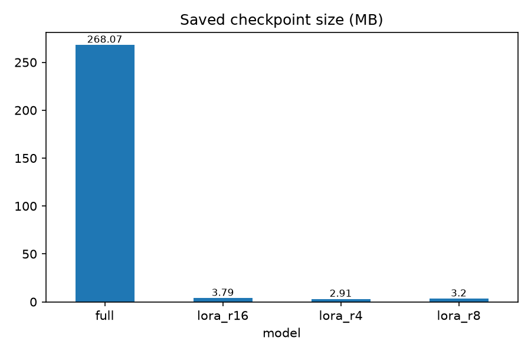
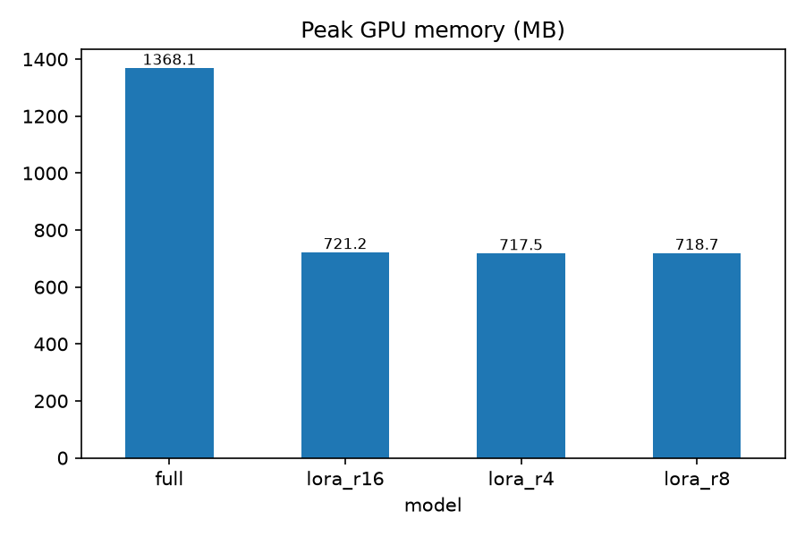
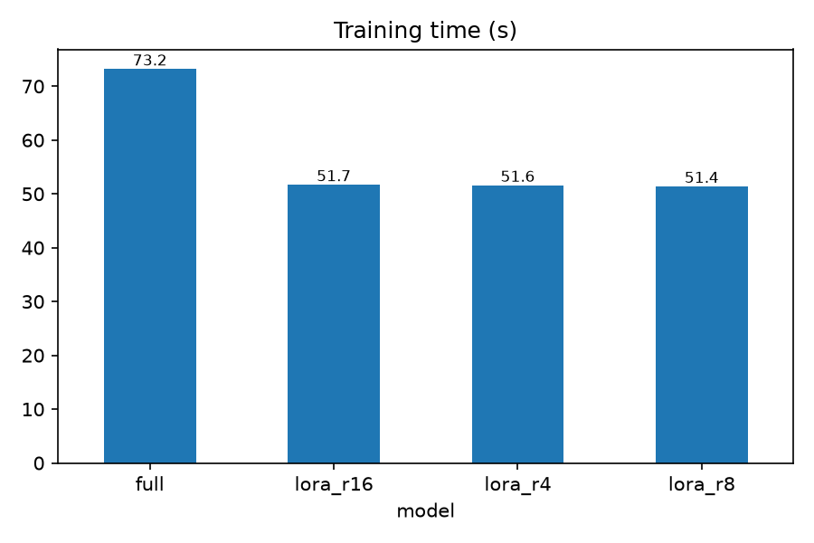

# Parameter-Efficient Fine-Tuning of Transformers with LoRA
**Overcoming High Training Cost for Indian Banking Customer Complaint Classification**

Name: Rima Dutta  Roll No.: 2548038  Class: 5MDS Subject: Gen-AI

## 1. Problem
Fully fine-tuning a Transformer updates every weight. This needs a lot of GPU memory, longer training time, and a full model copy (about 268 MB for DistilBERT) for every task.

## 2. Solution: LoRA (Low-Rank Adaptation)
The pretrained weight `W0` is frozen and only a low-rank update is learned:

```
W = W0 + (alpha / r) * B * A      B: d x r,  A: r x k,  r << min(d, k)
```

- `B` starts at zero, so training begins exactly from the pretrained model.
- LoRA is applied to the attention query and value layers (`q_lin`, `v_lin`) of DistilBERT.
- Settings: r = 8, alpha = 16, dropout = 0.1.
- Only about 1.2% of the parameters are trained.

## 3. Use case
A banking complaint classifier: the user types a complaint such as *"My UPI payment failed but money was deducted"* and the app predicts the category (top 3 with confidence).

## 4. Dataset
- **Banking77** (`PolyAI/banking77` on Hugging Face): 77 banking intents, 10,003 train and 3,080 test examples. It is downloaded automatically by the training code.
- **Indian-style test set** (`src/indian_test.csv`): 12 hand-written complaints (UPI, NEFT, IMPS, etc.) as a small robustness check. Banking77 is general banking, not India-specific.

## 5. Experiment setup
| Setting | Full fine-tuning (baseline) | LoRA (improved) |
|---|---|---|
| Model | distilbert-base-uncased | distilbert-base-uncased |
| Epochs | 5 | 5 |
| Learning rate | 5e-5 | 1e-3 |
| Batch size | 32 | 32 |
| Max length | 64 | 64 |
| Seed | 42 | 42 |
| GPU | Colab T4 | Colab T4 |

## 6. Results
| Model | Trainable params | Accuracy | Macro-F1 | Train time (s) | Peak GPU (MB) | Size (MB) | Latency (ms) | Indian test |
|---|---|---|---|---|---|---|---|---|
| Full fine-tuning | 67.0M (100%) | 92.69% | 0.9271 | 73.2 | 1368 | 268.07 | 7.73 | 7/12 |
| LoRA r=4 | 0.72M (1.07%) | 92.31% | 0.9230 | 51.6 | 718 | 2.91 | 8.66 | 8/12 |
| **LoRA r=8** | 0.80M (1.18%) | 91.95% | 0.9193 | 51.4 | 719 | 3.20 | 11.50 | 8/12 |
| LoRA r=16 | 0.94M (1.39%) | 92.31% | 0.9229 | 51.7 | 721 | 3.79 | 8.63 | 8/12 |

**LoRA (r=8) vs full fine-tuning:** about 84x fewer trainable parameters, about 47% less GPU memory, about 84x smaller checkpoint, about 30% faster training, with 0.74 points lower accuracy.







## 7. Discussion
- LoRA keeps accuracy within 1 point of full fine-tuning while training about 1% of the parameters.
- The rank has little effect: r=4, 8 and 16 all reach about 92%, so a small rank is enough.
- LoRA does not make inference faster, because the adapter is not merged into the base weights.
- The Indian-style test has only 12 sentences, so its result is only indicative.
- Limitations: single random seed, and small Indian test set. Future work: merge adapters for inference, try QLoRA and larger models, and collect real Indian complaint data.

## 8. Demo


## 9. How to run
**Train (Google Colab, T4 GPU):** upload the project and run `notebooks/train_and_benchmark.ipynb`.
Or from a terminal with a GPU:
```bash
pip install -r requirements.txt
python src/train.py --mode full --epochs 5
python src/train.py --mode lora --r 8
python src/benchmark.py
```
**Run the demo:**
```bash
pip install -r requirements.txt
python app/app.py
```
Open the link printed in the terminal (usually http://127.0.0.1:7860). The demo needs `models/lora_r8_adapter/`.

## 10. Project structure
```
src/train.py        train baseline and LoRA, log metrics
src/benchmark.py    build metrics.csv and charts
src/indian_test.csv Indian-style test complaints
app/app.py          Gradio demo
notebooks/          Colab notebook
results/            metrics.csv, charts, demo screenshot
models/             LoRA adapters
report/             Phase 1 and Phase 2 documents
```

## 11. References
- Hu et al., 2021. *LoRA: Low-Rank Adaptation of Large Language Models.*
- Sanh et al., 2019. *DistilBERT, a distilled version of BERT.*
- Casanueva et al., 2020. *Efficient Intent Detection with Dual Sentence Encoders* (Banking77).
